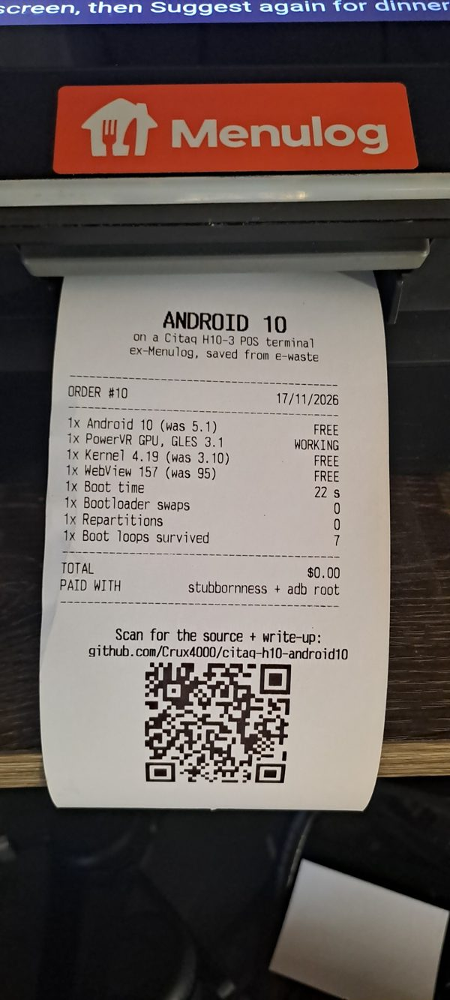
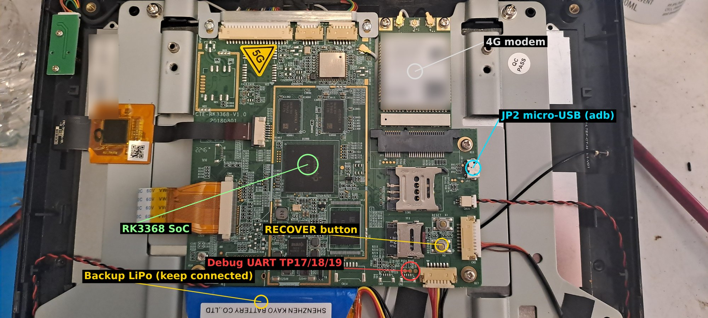

# Android 10 on the Citaq H10-3 POS terminal (RK3368), with GPU acceleration

The Citaq H10-3 is a 10" Android point-of-sale terminal with a built-in 80 mm receipt printer.
Ex-Menulog / Just Eat units are turning up free or cheap, and they make a great wall kiosk, but they
ship with **Android 5.1 from 2016**. Modern browsers and the Home Assistant app no longer run on it.

This repo takes one of those terminals to **Android 10 with working PowerVR GPU acceleration**. The
receipt printer, LEDs, touch, Wi-Fi, Bluetooth, sound and Google Play all work. It does this **without replacing
the bootloader and without repartitioning**, and the stock Android 5.1 stays on the eMMC as a
fallback.

**The story behind it**, with photos (finding the terminal, the boot loops, the fake temperature, the Home
Assistant side), is on Hackster: [From E-Waste Order Terminal to Home Assistant Kiosk](https://www.hackster.io/crux4000/from-e-waste-order-terminal-to-home-assistant-kiosk-f9618b).

> **Tried it? Please report back, good or bad.** So far this has been done on two terminals (Just Eat's
> build and Citaq's generic `POS_32` build). The second one's install turned up several bugs, all fixed
> now ([#4](https://github.com/Crux4000/citaq-h10-android10/issues/4)).
> Whether it worked, half-worked or ended in maskrom, a quick
> **[device report](https://github.com/Crux4000/citaq-h10-android10/issues/new?template=device-report.yml)**
> adds your unit to the **[device list](docs/DEVICES.md)** and helps the next person. Reports from other
> H10-3 stock builds and from other RK3368 hardware are the most useful. Just running the `getprop`
> checks and reporting what you have counts too.


| | |
|:---:|:---:|
|  |  |
| Settings → About tablet | printed from Home Assistant |

| | |
|---|---|
| Hardware | Citaq H10-3, Rockchip RK3368 (8× Cortex-A53), PowerVR G6110, 2 GB RAM, 16 GB eMMC, 1024×768 LVDS |
| Before | Android 5.1.1, kernel 3.10, security patch 2016-04-01, WebView 95 |
| After | Android 10 (Rockchip PX5 build), kernel 4.19.111, **OpenGL ES 3.1 on the G6110**, WebView 157, current Play Store and HA app |
| Boot | ~22 s to `boot_completed` (stock U-Boot, eMMC at HS200) |

## How it works, in one paragraph

The RK3368 is the same chip as the **PX5**, which sits inside thousands of Android car head units. Those
got an Android 10 build from Rockchip, and that build carries the **newest G6110 GPU driver there is**.
The open-source Mesa/PowerVR driver lists this GPU as unsupported, so mainline Linux would mean
software rendering. This port takes the PX5 Android 10 kernel and system and boots them on the
Citaq's own 2019 U-Boot. To make that work it:

- writes a new device tree for the Citaq hardware
- puts the dynamic `super` partition inside the old internal-storage area
- byte-patches the car firmware so it stops waiting for a car that isn't there
- fills the gaps with small userspace drivers for touch, backlight and volume

The full story, including every boot loop and its fix, is in **[docs/PORTING-NOTES.md](docs/PORTING-NOTES.md)**.

## What works

| Feature | Status | Notes |
|---|---|---|
| GPU (PowerVR Rogue G6110) | ✅ | GLES 3.1, 200/288/400 MHz DVFS |
| Display 1024×768 LVDS | ✅ | JEIDA 24-bit; rotated 180° for the assembled case |
| Touch (Ilitek ILI2105) | ✅ | userspace driver `ilits` (I2C → uinput), 2 fingers |
| Wi-Fi (AP6256 or AP6255, 2.4 + 5 GHz) | ✅ | rebuilt `bcmdhd.ko`; AP6255 uses Cypress firmware (see [docs/WIFI.md](docs/WIFI.md)) |
| Bluetooth (BCM4345C5 / BCM4345C0) | ✅ | speakers, headsets; see [docs/BLUETOOTH.md](docs/BLUETOOTH.md) |
| Ethernet (RTL8152) | ✅ | |
| 4G modem (Fibocom NL668) | ⚠️ | powers up, AT commands, sees all carriers; **untested with a SIM**. Some units have a Huawei ME909s instead (powers up and answers AT commands; untested with a SIM). See [docs/MODEM.md](docs/MODEM.md) |
| Sound (RT5651 or ES8316 + speaker amp) | ✅ | the boot hook detects which codec is fitted; Android volume works through `volshim`. Detection confirmed on both: RT5651 on the reference terminal (22 Nov 2026), ES8316 on a second terminal (21 Nov 2026); the ES8316 volume slider fix is awaiting a test |
| Headphone jack | ✅ | built-in speakers mute while something is plugged in |
| Brightness slider | ✅ | through `blshim` |
| Screen off (sleep) | ⚠️ | the car firmware ignores sleep requests; `script.kiosk_screen` switches the backlight off instead ([HA guide](docs/HOME-ASSISTANT.md#screen-off)) |
| Receipt printer (`/dev/ttyS1`) | ✅ | ESC/POS, same paths as stock, so existing scripts keep working |
| Red / blue LEDs | ✅ | gpio124 / gpio106 |
| 3 USB host ports | ✅ | barcode scanners, mice, flash drives, SDR dongles |
| adb over USB (JP2) and network | ✅ | userdebug build, `adb root` works |
| Google Play / sign-in | ✅ | with a `thermalservice` stub and a serial-number fix |
| CPU DVFS + thermal | ✅ | 408 MHz–1 GHz by default, 1.2 / 1.5 GHz opt-in; temperature reading and throttling fixed 21 Nov 2026, see [Known issues](#known-issues) |
| Back power switch | ✅ | clean shutdown and real power-off |
| Survives a battery pull | ✅ | the boot hook re-programs the PMIC |
| Battery % / charge status | ❌ | no RK818 driver; charging itself works |
| Android's own "Power off" | ⚠️ | halts but stays powered; use the back switch |
| Hardware volume keys / MTC volume slider | ⚠️ | go to the (absent) car MCU; use any app that uses Android's media volume |

## Do I have the right terminal?

You need **all** of these. The scripts check most of them and stop if something doesn't match.

- **Citaq H10-3** with the `CTE-RK3368-V1.0` board and a 16 GB eMMC (`ro.board.platform=rk3368`)
- the stock **userdebug** build, so `adb root` works. Ex-Menulog units with build
  `20220926.JE.H10.5.1.0005` (`ro.product.device=justeat_32`) are. Check with
  `adb shell getprop ro.build.type`. A `user` build can't be rooted this way.
  [docs/DEVICES.md](docs/DEVICES.md) lists every build and board reported so far.
- **the case open** on the bench, because you need the internal **JP2 micro-USB** for adb on Android
  10's first boot. A 3.3 V USB-serial adapter on the debug UART is strongly recommended.

<a href="docs/HARDWARE.md#getting-inside"></a>

*Inside the H10-3: everything you need is in the bottom-right corner of the board. Details in [HARDWARE.md](docs/HARDWARE.md#getting-inside).*

## Getting started

1. Read **[docs/INSTALL.md](docs/INSTALL.md)** end to end before starting.
2. Back up your whole eMMC. The guide shows how.
3. Build the image, test it from the **recovery slot** (stock still boots normally), then make it the
   default.

Rolling back is one command (`tools/flash_slot.py … boot <your backup>`), and the stock 5.1 system is
never touched. See [docs/RECOVERY.md](docs/RECOVERY.md).

## Repo layout

```
tools/        PC side (Python 3, no Android SDK needed)
  extract_px5_boot.py    pull kernel / ramdisk / DTB out of the PX5 boot.img
  build_px5_a10.py       build the Citaq boot image (Rockchip SHA-1 header hash)
  super_to_citaq.py      write super.img into the user area over adb, with MD5 checks
  super_files.py         read/patch files inside super.img (applies patches/*.json on the device)
  flash_slot.py          write an image to the boot or recovery slot - checks, backup, verify
  install_data.py        push the boot hook + helpers to /data/citaq
  rkbootimg.py           shared Rockchip boot-image helpers
  dump_stock_dtb.py      copy a terminal's stock device tree off (read-only), to compare boards
dtb/          device-tree scripts (PX5 EVB DTB -> Citaq H10-3), need dtc/fdtput
patches/      byte patches for super: CarService null fix, odex hide, touch service
device/       on-terminal scripts: citaq-boot.sh (the boot hook), debloat/restore, bt/bt_vendor.conf, modem/at-probe.sh
src/          static arm64 helpers (C) + thermalstub (Java); build.sh builds them
firstlight/   optional kernel bring-up test (busybox initramfs) for adapting to other boards
ha/           Home Assistant package: printer, LED patterns, app relaunch over adb
.github/      issue template for device reports
docs/         install, recovery, device list, hardware map, porting notes, Wi-Fi driver, Bluetooth, 4G modem, Home Assistant
```

## What is *not* in this repo

- **The PX5 firmware** (Rockchip/HCT `CHS7_PX5_10.0_IMG(20200603)`). You download it yourself from
  the [Hal9k Firmware Library](https://hal9k.ru/?page_id=7), and the tools extract and patch it on your PC.
- **Google apps** (Play services, Play Store). Sideload them from a trusted mirror.
- **`bcmdhd.ko`**. It's GPL and built from Rockchip's public kernel tree, and it's attached to the
  GitHub release along with the exact source commit and config. See [docs/WIFI.md](docs/WIFI.md).
- **`BCM4345C5.hcd` / `BCM4345C0.hcd`** (Bluetooth firmware for the two Wi-Fi/BT modules Citaq fits).
  Download both from Armbian's firmware repo; the links and MD5s are in [docs/BLUETOOTH.md](docs/BLUETOOTH.md).

## Known issues

- **The printer beeps non-stop.** It's the receipt printer's own alarm, usually no paper or the lid
  open, and it can go off on the bench too. Turn its buzzer off with:
  ```sh
  adb shell "printf '\037\033\037\120\102' > /dev/ttyS1"
  ```
  The same command works from Windows (cmd or PowerShell) and Linux, and doesn't need root (on stock
  5.1, if it says `printf: not found`, use `busybox printf` instead). It sends
  the Citaq printer command `1F 1B 1F 50 42`. The setting is lost when the printer powers off. With
  the [Home Assistant package](docs/HOME-ASSISTANT.md#the-beeper), leave the **Kiosk printer beeper**
  switch off and HA re-sends it whenever the terminal comes back. If your printer has been taken out
  and something still beeps, this command can't reach it.

- **No sound card? Your terminal may have the other codec (support added 21 Nov 2026, confirmed working).**
  Citaq fits either a Realtek RT5651 or an Everest ES8316 sound chip, with identical stock firmware.
  Earlier builds only set up the RT5651, so an ES8316 terminal had no sound at all. Check yours with
  `adb root`, then `adb shell i2cdetect -y 1` on a build from before 21 Nov: `UU` or `1a` at 0x1a is the
  RT5651, `10` at 0x10 is the ES8316. (From the new build on, the es8316 driver claims 0x10 on every
  terminal, so it shows `UU` there either way; use `sound.log` below.) The boot hook now detects which one
  is fitted and sets up the matching sound card. To update:
  pull, rebuild the DTB and boot image ([INSTALL step 5](docs/INSTALL.md#5-build-the-dtb-and-boot-image-linuxwsl)),
  flash it to the boot slot ([Updating the boot image later](docs/INSTALL.md#updating-the-boot-image-later)),
  rebuild the helpers (`sh src/build.sh`) and re-run step 10 (`install_data.py`) for the new boot hook and
  `volshim`. After a reboot, `adb shell cat /data/citaq/sound.log` says which codec was found and whether
  the card came up. On an RT5651 terminal nothing changes.

- **Wi-Fi drops after about 13 minutes and doesn't come back (AP6255 terminals, fixed 22 Nov 2026).**
  The AP6255's default firmware (`fw_bcm43455c0_ag.bin`) crashes: `dmesg` shows a `TRAP` /
  `FIRMWARE HALTED`. The boot hook now swaps in Cypress's firmware for the same chip
  (`fw_cyw43455.bin`, also in the image), which ran overnight without a crash. Terminals with the
  AP6256 load a different file and aren't affected.
  **Installed before 22 Nov 2026 on an AP6255?** Pull and push the new hook (no reflash needed):
  `adb root`, `adb push device/citaq-boot.sh /data/citaq/ilits`, `adb shell chmod 755 /data/citaq/ilits`,
  `adb reboot`. To check: `adb shell "dmesg | grep -m1 'Firmware: wl0'"` should end in `CY`.
  (Not sure which module you have? `adb shell "dmesg | grep -m1 'chip:0x4345'"` shows `rev:0x9` on an
  AP6256 and `rev:0x6` on an AP6255.)

- **It runs hot. Temperature reading fixed 21 Nov 2026, which most likely also fixes the freeze
  (rebuild your boot image).**
  These terminals have no heatsink on the SoC, and there are only a couple of millimetres between the
  chip and the case.
  - **What was wrong:** the DTB disabled the 32 kHz clock that the temperature sensor runs from, so the
    built-in reading was stuck or garbage. Throttling never engaged, and a garbage reading could hit the
    125 °C critical trip, which on this port halts the board with the screen off but still powered. On
    19 Nov 2026 one terminal froze in exactly that way after about 3 hours at 1.2 GHz (touch and adb
    dead, back after a power-cycle); that's the most likely cause, though the freeze wasn't
    reproduced. The sensor also needed the live CPU voltage instead of a fixed one. Both are fixed in
    the DTB scripts; details in [docs/HARDWARE.md](docs/HARDWARE.md#thermal).
  - **Checked on the bench** with a probe on the chip: about 4 °C high at idle, and under 10 minutes of
    full load the reading peaked at 80 °C and throttling held it there (the probe on the package top
    read 59 °C).
  - **First night back in service** (21–22 Nov 2026, case closed, 24–25 °C room, CPU limit 1512): 14 hours
    with no freeze. The reading moved smoothly between about 55 and 66 °C on the dashboard, with no stuck
    values or spikes, and peaked at 80 °C (throttled) only during a Play Store update. That's one night,
    so it isn't proof yet; this note will be updated after a week.
  - **Installed before 21 Nov 2026?** Your terminal has the broken sensor. Pull, rebuild the DTB and
    boot image ([INSTALL step 5](docs/INSTALL.md#5-build-the-dtb-and-boot-image-linuxwsl)) and flash
    it to the boot slot ([Updating the boot image later](docs/INSTALL.md#updating-the-boot-image-later)).
    Check it worked: `adb root`, then
    `adb shell "grep -e xin32k -e tsadc /sys/kernel/debug/clk/clk_summary"` should show both at 32768.
    Update the boot hook as well, since only the current one has the 1.5 GHz option:
    `adb root`, `adb push device/citaq-boot.sh /data/citaq/ilits`, `adb shell chmod 755 /data/citaq/ilits`
    (or re-run `install_data.py`).

  **The CPU defaults to 1008 MHz** (since 20 Nov 2026). It runs cooler and makes no noticeable
  difference in the Home Assistant app. 1.2 GHz and 1.5 GHz (big cluster only, for heatsink or fan mods)
  are opt-ins ([docs/HARDWARE.md](docs/HARDWARE.md#cpu-speed-limit)); both need the fixed DTB, because
  they rely on throttling. Set it with `adb root`, then
  `adb shell "echo 1200 > /data/citaq/cpu-max-mhz"` (or `816`, `1008`, `1512`) and reboot;
  `adb shell cat /data/citaq/cpu.log` shows what was applied. Boot hooks from before 20 Nov ignore that
  file and run at 1.2 GHz, so update the hook as above. If you get freezes with the fixed DTB, please
  open an issue.

## Warning

This writes to the eMMC of a device that has no official recovery path apart from Rockchip's
maskrom tools. It has been done on two terminals so far and works on both. The scripts check partition
positions and MD5s before writing, and they back up what they replace. Even so, **you do this at your
own risk**, and you should keep the full eMMC backup somewhere safe.

## Credits

- The PX5 head-unit community and the **Hal9k** firmware library, for keeping these images available
- Rockchip's open `develop-4.19` kernel tree (Wi-Fi driver rebuild) and their vendor device trees
- The mainline `ili210x` driver (touch protocol) and the mainline `rk808` / Pinephone Pro RK818 work (32 kHz clock fix)
- **[@mildlycooldad](https://github.com/mildlycooldad)**, the first person to install this on their own
  terminal. Their reports and testing turned up the eMMC-numbering and bigger-eMMC bugs, the newer-`dtc`
  script bug and the Linux tool quirks (all now fixed), and brought support for the ES8316 sound chip
  and the AP6255 Wi-Fi/Bluetooth module. They also pinned down the AP6255 Wi-Fi drop and proved the firmware that
  fixes it, and their heat report led to the safer default CPU limit. Every terminal after the
  first installs more easily because of it. Thank you!

## Licence

Copyright (C) 2026 Crux4000

The code and docs in this repo are licensed under the **GNU General Public License v3.0 or later**
(see [LICENSE](LICENSE)). You're free to use, modify and share them, including commercially, but if you
distribute this work or anything built from it (for example, terminals sold with it installed), you
must make the complete source available under the same licence.

Copies obtained before 18 November 2026 were released under the MIT licence.

The PX5 firmware, Google apps and the Linux kernel / `bcmdhd` remain under their own licences.
