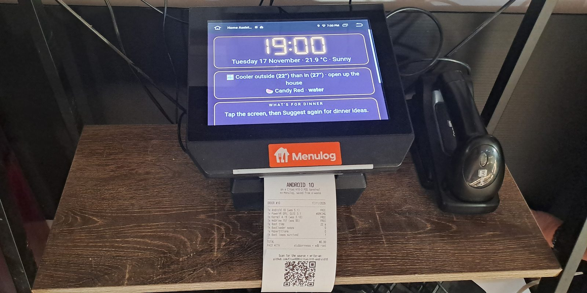

# Android 10 on the Citaq H10-3 POS terminal (RK3368), with GPU acceleration

The Citaq H10-3 is a 10" Android point-of-sale terminal with a built-in 80 mm receipt printer.
Ex-Menulog / Just Eat units are turning up free or cheap, and they make a great wall kiosk, but they
ship with **Android 5.1 from 2016**. Modern browsers and the Home Assistant app no longer run on it.

This repo takes one of those terminals to **Android 10 with working PowerVR GPU acceleration**. The
receipt printer, LEDs, touch, Wi-Fi, sound and Google Play all work. It does this **without replacing
the bootloader and without repartitioning**, and the stock Android 5.1 stays on the eMMC as a
fallback.

<!-- Add a photo of the terminal running Android 10 here, e.g.  -->

| | |
|---|---|
| Hardware | Citaq H10-3, Rockchip RK3368 (8× Cortex-A53), PowerVR G6110, 2 GB RAM, 16 GB eMMC, 1024×768 LVDS |
| Before | Android 5.1.1, kernel 3.10, security patch 2016-04-01, WebView 95 |
| After | Android 10 (Rockchip PX5 build), kernel 4.19.111, **OpenGL ES 3.1 on the G6110**, WebView 157, current Play Store and HA app |
| Boot | ~22 s to `boot_completed` (stock U-Boot, eMMC at HS200) |

## How it works, in one paragraph

The RK3368 is the same chip as the **PX5**, which sits inside thousands of Android car head units. Those
got an Android 10 build from Rockchip, and that build carries the **newest G6110 GPU driver there is**.
The open-source Mesa/PowerVR driver lists this GPU as unsupported, so mainline Linux would mean
software rendering. This port takes the PX5 Android 10 kernel and system and boots them on the
Citaq's own 2019 U-Boot. To make that work it:

- writes a new device tree for the Citaq hardware
- puts the dynamic `super` partition inside the old internal-storage area
- byte-patches the car firmware so it stops waiting for a car that isn't there
- fills the gaps with small userspace drivers for touch, backlight and volume

The full story, including every boot loop and its fix, is in **[docs/PORTING-NOTES.md](docs/PORTING-NOTES.md)**.

## What works

| Feature | Status | Notes |
|---|---|---|
| GPU (PowerVR Rogue G6110) | ✅ | GLES 3.1, 200/288/400 MHz DVFS |
| Display 1024×768 LVDS | ✅ | JEIDA 24-bit; rotated 180° for the assembled case |
| Touch (Ilitek ILI2105) | ✅ | userspace driver `ilits` (I2C → uinput), 2 fingers |
| Wi-Fi (AP6256, 2.4 + 5 GHz) | ✅ | rebuilt `bcmdhd.ko` (see [docs/WIFI.md](docs/WIFI.md)) |
| Ethernet (RTL8152) | ✅ | |
| Sound (RT5651 + speaker amp) | ✅ | Android volume works through `volshim` |
| Brightness slider | ✅ | through `blshim` |
| Receipt printer (`/dev/ttyS1`) | ✅ | ESC/POS, same paths as stock, so existing scripts keep working |
| Red / blue LEDs | ✅ | gpio124 / gpio106 |
| 3 USB host ports | ✅ | barcode scanners, mice, flash drives, SDR dongles |
| adb over USB (JP2) and network | ✅ | userdebug build, `adb root` works |
| Google Play / sign-in | ✅ | with a `thermalservice` stub and a serial-number fix |
| CPU DVFS + thermal | ✅ | 408 MHz–1.2 GHz; 1.5 GHz is unstable without a heatsink |
| Back power switch | ✅ | clean shutdown and real power-off |
| Survives a battery pull | ✅ | the boot hook re-programs the PMIC |
| Battery % / charge status | ❌ | no RK818 driver; charging itself works |
| Android's own "Power off" | ⚠️ | halts but stays powered; use the back switch |
| Hardware volume keys / MTC volume slider | ⚠️ | go to the (absent) car MCU; use any app that uses Android's media volume |
| Headphone-jack detect, Bluetooth, 4G modem | ❓ | not done / untested |

## Do I have the right terminal?

You need **all** of these. The scripts check most of them and stop if something doesn't match.

- **Citaq H10-3** with the `CTE-RK3368-V1.0` board and a 16 GB eMMC (`ro.board.platform=rk3368`)
- the stock **userdebug** build, so `adb root` works. Ex-Menulog units with build
  `20220926.JE.H10.5.1.0005` (`ro.product.device=justeat_32`) are. Check with
  `adb shell getprop ro.build.type`. A `user` build can't be rooted this way.
- **the case open** on the bench, because you need the internal **JP2 micro-USB** for adb on Android
  10's first boot. A 3.3 V USB-serial adapter on the debug UART is strongly recommended.

## Getting started

1. Read **[docs/INSTALL.md](docs/INSTALL.md)** end to end before starting.
2. Back up your whole eMMC. The guide shows how.
3. Build the image, test it from the **recovery slot** (stock still boots normally), then make it the
   default.

Rolling back is one command (`tools/flash_slot.py … boot <your backup>`), and the stock 5.1 system is
never touched. See [docs/RECOVERY.md](docs/RECOVERY.md).

## Repo layout

```
tools/        PC side (Python 3, no Android SDK needed)
  extract_px5_boot.py    pull kernel / ramdisk / DTB out of the PX5 boot.img
  build_px5_a10.py       build the Citaq boot image (Rockchip SHA-1 header hash)
  super_to_citaq.py      write super.img into the user area over adb, with MD5 checks
  super_files.py         read/patch files inside super.img (applies patches/*.json on the device)
  flash_slot.py          write an image to the boot or recovery slot - checks, backup, verify
  install_data.py        push the boot hook + helpers to /data/citaq
  rkbootimg.py           shared Rockchip boot-image helpers
dtb/          device-tree scripts (PX5 EVB DTB -> Citaq H10-3), need dtc/fdtput
patches/      byte patches for super: CarService null fix, odex hide, touch service
device/       on-terminal scripts: citaq-boot.sh (the boot hook), debloat/restore
src/          static arm64 helpers (C) + thermalstub (Java); build.sh builds them
firstlight/   optional kernel bring-up test (busybox initramfs) for adapting to other boards
ha/           Home Assistant package: printer, LEDs, app relaunch over adb
docs/         install, recovery, hardware map, porting notes, Wi-Fi driver, Home Assistant
```

## What is *not* in this repo

- **The PX5 firmware** (Rockchip/HCT `CHS7_PX5_10.0_IMG(20200603)`). You download it yourself from
  the Hal9k firmware library, and the tools extract and patch it on your PC.
- **Google apps** (Play services, Play Store). Sideload them from a trusted mirror.
- **`bcmdhd.ko`**. It's GPL and built from Rockchip's public kernel tree, and it's attached to the
  GitHub release along with the exact source commit and config. See [docs/WIFI.md](docs/WIFI.md).

## Warning

This writes to the eMMC of a device that has no official recovery path apart from Rockchip's
maskrom tools. Everything here was done on one terminal and works there. The scripts check partition
positions and MD5s before writing, and they back up what they replace. Even so, **you do this at your
own risk**, and you should keep the full eMMC backup somewhere safe.

## Credits

- The PX5 head-unit community and the **Hal9k** firmware library, for keeping these images available
- Rockchip's open `develop-4.19` kernel tree (Wi-Fi driver rebuild) and their vendor device trees
- The mainline `ili210x` driver (touch protocol) and the mainline `rk808` / Pinephone Pro RK818 work (32 kHz clock fix)

## Licence

Copyright (C) 2026 Crux4000

The code and docs in this repo are licensed under the **GNU General Public License v3.0 or later**
(see [LICENSE](LICENSE)). You're free to use, modify and share them, including commercially, but if you
distribute this work or anything built from it (for example, terminals sold with it installed), you
must make the complete source available under the same licence.

Copies obtained before 18 November 2026 were released under the MIT licence.

The PX5 firmware, Google apps and the Linux kernel / `bcmdhd` remain under their own licences.
