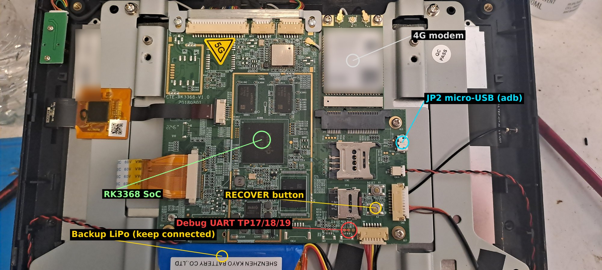
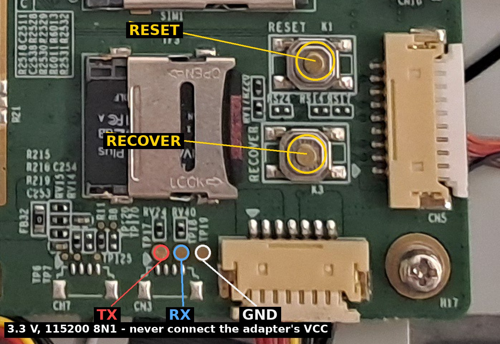

# Citaq H10-3 hardware map

Everything below was read from a live terminal (stock 5.1 and the Android 10 port), the stock 3.10
device tree, or the stock POSFactory test app. Board: **CTE-RK3368-V1.0**. On the H10-3 the compute
board sits **behind the screen**, not in the base.

## Getting inside

The compute board sits behind the screen. Everything you need for the port is in its bottom-right corner.



**Debug UART close-up.** TX and RX are labelled from the *board's* side, so wire adapter **RX → TP17**,
adapter **TX → TP18** and **GND → TP19**. Thin wires soldered to the pads are much easier than holding
probes during a boot. If nothing shows up in your terminal, swap the TP17/TP18 wires; doing that is
harmless. CN3/CN7 are empty footprints and aren't needed.



## Overview

| Part | Detail |
|---|---|
| SoC | Rockchip RK3368, 4× + 4× Cortex-A53, PowerVR **G6110** (BVNC 5.9.1.46) |
| RAM | 2 GB DDR3 (2× Samsung K4B4G16) |
| eMMC | Samsung 16 GB (14,910 MiB), HS200 under 4.19 (stock ran 50 MHz) |
| Display | 10" 1024×768 4:3, **LVDS single-channel 8-bit, JEIDA**, 65 MHz |
| Touch | Ilitek **ILI2105**, I2C2 (`i2c@ff140000`) addr **0x41**, IRQ gpio0 B4 (gpio12, low = data), reset gpio0 B3 (gpio11) |
| PMIC | Rockchip **RK818** on I2C0 @ 0x1c, plus **Silergy SYR827** (vdd_cpu) @ 0x40 |
| Wi-Fi/BT | **AP6256** (BCM4345 rev 9, 2.4 + 5 GHz) on SDIO0. The stock DT says AP6212, which is wrong. Bluetooth core **BCM4345C5** on **UART0 → /dev/ttyS0** |
| Audio | **Realtek RT5651** on I2C1 @ 0x1a **or Everest ES8316** @ 0x10 (Citaq fits either; same stock firmware, which lists both - the boot hook detects which and binds the matching sound card, result in `/data/citaq/codec`), i2s-8ch, MCLK = SCLK_I2S_8CH_OUT; speaker amp gpio0 C3 (gpio19), **active high**. The headphone jack and the speaker amp share the headphone output, so the boot hook mutes the amp while the jack is in. The ES8316 has no line out; its speaker amp is the same pin |
| Printer | 80 mm thermal, ESC/POS, **UART1 → /dev/ttyS1, 115200, CTS flow control**, 552 dots wide. Buzzer off: `1F 1B 1F 50 42` (Citaq-specific; `1F 1B 1F 50 40` didn't silence it, so it's probably buzzer on, untested) |
| LEDs | red **gpio124**, blue **gpio106** (1 = on) |
| USB | internal GL850G hub (1-1) → Fibocom NL668-EAU 4G modem (1-1.1, see [MODEM.md](MODEM.md)); rear hub GL850G (1-1.3) → 3 ports + RTL8152 Ethernet (1-1.3.4) |
| JP2 | internal micro-USB = dwc2 OTG (`usb@ff580000`) = adb port |
| Debug UART | UART2: **TP17** board TX, **TP18** board RX, **TP19** GND, 3.3 V, 115200 |
| Buttons | power key gpio0 A2 (active low); RECOVER / RESET on the compute board |
| Battery | 1S 3.7 V 1600 mAh LiPo (backup). The board won't run without it |
| Power | 24 V 2.5 A barrel; the back switch cuts DC input (and the printer) |
| Other | DS2411 1-wire silicon serial on gpio3 B4 (unused so far); no camera |

GPIO numbers are Linux numbers: `bank × 32 + letter × 8 + pin` (A=0, B=1, C=2, D=3).

## Other GPIOs

| GPIO | Pin | Use |
|---|---|---|
| 29 | gpio0 D5 | LCD reset (release high) |
| 30 | gpio0 D6 | LCD chip select / power (high) |
| 31 | gpio0 D7 | stock init-gpio (high) |
| 81 | gpio2 C1 | stock init-gpio (high) - possibly printer power |
| 114 | gpio3 C2 | LCD enable (high) |
| 100 / 102 | gpio3 A4 / A6 | Wi-Fi WL_REG_ON (via mmc-pwrseq) / host wake |
| 99 / 101 | gpio3 A3 / A5 | Bluetooth power / BT_REG_ON (via rfkill-bt) |
| 98 / 103 | gpio3 A2 / A7 | Bluetooth BT_WAKE / host wake |
| 91 | gpio2 D3 | UART0 RTS (Bluetooth), active low |
| 28 | gpio0 D4 | 4G modem power key (high = released) |
| 109 / 105 | gpio3 B5 / B1 | 4G modem reset / W_DISABLE (high = running, radio on) |
| 15 | gpio0 B7 | headphone-jack detect, active low (0 = plugged in); needs its pull-up on (the DTB does it) |

## Backlight

PWM0 (`pwm@ff680000`, pin GPIO3_B0), period 25 µs, **normal polarity**, duty 0 = off. In the port,
the MTC `pwm-backlight` driver is pointed at the unused PWM3 and `blshim` drives PWM0 through sysfs.

## RK818 PMIC

I2C0 address 0x1c (`i2cget -f -y 0 0x1c <reg>`). With no driver, these are the registers that matter.
Stock values are restored by `citaq-boot.sh`. OTP values are what you get after a battery pull.

| Reg | Name | Stock | OTP / notes |
|---|---|---|---|
| 0x20 | CLK32OUT | bit0 = 1, bit1 = 0 (32 kHz out) | 0x02: pin not a clock → Wi-Fi "HT Avail timeout" |
| 0x23 | DCDC_EN | 0x7f | ok |
| 0x24 | LDO_EN | **0xff** | 0x54 (only LDO3/5/7) → blank LCD, dead touch |
| 0x2f | BUCK1 (vdd_logic, GPU) | 0x22 = 1.1375 V | 0x1f = 1.1 V |
| 0x33 | BUCK2 | 0x1f = 1.1 V | — |
| 0x3b | LDO1 | 0x0f = 3.3 V | 0x00 |
| 0x3d | LDO2 (vcc_tp, touch) | 0x0f = 3.3 V | 0x00 |
| 0x45 | LDO6 | 0x02 = 1.0 V | 0x00 = 0.8 V |
| 0x4b | DEVCTRL | write 0x01 = DEV_OFF (power off) | |
| 0xa0 | SUP_STS | bit1 = DC input present (0xbf on DC, 0x8c on battery) | |
| 0xa1 | USB_CTRL | low nibble 0xb = 3 A input limit | 0 = 450 mA |
| 0xa3 | CHRG_CTRL1 | 0x80 = 4.05 V / 1.0 A | 0xb5 = 4.2 V / 2.0 A |

The charger runs on its own once programmed, so charging works without a driver. Only the battery %
reading is missing.

## SYR827 (vdd_cpu)

I2C0 @ 0x40, ID 0x88. VSEL0 = 0xa4 (enabled, 1162.5 mV) at boot, VSEL1 = sleep. Driven in the port by
the `fan53555` driver (`fcs,suspend-voltage-selector = 1`). Up to 1.35 V for the big cluster at 1512 MHz;
the boot hook sets the speed limit (below).

## CPU speed limit

The little cluster (cpu0–3) tops out at 1.2 GHz; the big cluster (cpu4–7) has 1296/1416/1512 MHz as well.
Both share the SYR827 rail, so it runs at whatever the busier cluster needs:

| Limit | cpu0–3 | cpu4–7 | Rail at full speed | Notes |
|---|---|---|---|---|
| 1512 MHz | 1200 MHz | 1512 MHz | 1.35 V | for heatsink/fan mods; see below |
| 1200 MHz | 1200 MHz | 1200 MHz | 1.225 V | fastest sustained on stock cooling; about 40% more CPU heat than 1008 |
| 1008 MHz (default) | 1008 MHz | 1008 MHz | 1.125 V | barely noticeable on a dashboard |
| 816 MHz | 816 MHz | 816 MHz | 1.025 V | coolest; slower boot and app installs |

**Why 1008 is the default.** The stock Android 5.1 firmware allowed 1.2 GHz on the little cluster and
1.5 GHz on the big one, so none of these is beyond what the chip shipped with. But stock throttled on a
temperature reading it could trust, and until 21 Nov 2026 this port's reading was broken (see
[Thermal](#thermal)), so a hot terminal never throttled. With a DTB built after that date throttling
works, but with no heatsink 1008 MHz still runs cooler and is barely slower on a dashboard, so it stays
the default. **1200 and 1512 need a DTB from 21 Nov 2026 or later**, because they rely on throttling.

**1512 on stock cooling** (bench test, case open, 33 °C room): no hangs, but under sustained full load
the 70 °C throttle pulls cpu4–7 back to 1200 MHz or less within 1–2 s. Short single-thread jobs ran 20%
faster than at 1200; ten minutes of all-core load got about 10% more work done, at the same temperature.
With a heatsink or fan it should hold the higher speeds for longer. (Earlier versions dropped these
speeds because 1512 MHz hung the board after 30–70 s of full load on 17 Nov 2026, while the temperature
sensor was broken and nothing throttled.)

The boot hook reads the limit from `/data/citaq/cpu-max-mhz` (`816`, `1008`, `1200` or `1512`; anything
else, or no file, means 1008) and logs what it set to `/data/citaq/cpu.log`.

Set it for every boot (here 1200):

```sh
adb root
adb shell "echo 1200 > /data/citaq/cpu-max-mhz"
```

Apply it now as well, without rebooting:

```sh
adb shell 'for p in /sys/devices/system/cpu/cpufreq/policy*; do echo 1200000 > $p/scaling_max_freq; done'
```

For 1512, cpu0–3 stay at 1200:
`adb shell "echo 1200000 > /sys/devices/system/cpu/cpufreq/policy0/scaling_max_freq; echo 1512000 > /sys/devices/system/cpu/cpufreq/policy4/scaling_max_freq"`

Delete the file to go back to the default 1008 MHz. Check with
`adb shell cat /sys/devices/system/cpu/cpufreq/policy0/scaling_max_freq`.

## Thermal

`tsadc@ff280000`, legacy rk3368 driver. Three things it needs on this board:
1. **Its clock.** `sclk_tsadc` comes from `xin32k`. On the PX5, `/xin32k` is a PWM-generated clock; on
   the Citaq the RK818's CLK32KOUT1 feeds the SoC's CLK32K ball directly. Before 21 Nov 2026 the port
   disabled `/xin32k` with the other car-only nodes, which left `sclk_tsadc` an orphan at 0 Hz
   (`/sys/kernel/debug/clk/clk_orphan_summary`). Conversions then never finish in the driver's window and
   it silently keeps returning the last value: readings stuck for hours, occasional garbage spikes to
   119–125 °C, and throttling that never engages. The DTB now declares `/xin32k` as a 32768 Hz
   `fixed-clock`, like the mainline RK3368 boards.
2. **The live CPU voltage.** The driver multiplies the raw code by `tsadc-supply` volts, and with a working
   clock that is correct: the raw code scales as 1/vdd_cpu (code x V about 153 at every speed from 408 to
   1200 MHz with the chip at about 50 °C). So `tsadc-supply` is the SYR827 `vdd_cpu`. Older versions used a
   fixed 1.1625 V reference here, based on readings that turned out to be stale values from the dead clock.
3. **`latency-bound = 0x7fffffff`.** Otherwise it asks the MCU over SCPI for the reading unless a
   low-latency PM QoS request is active, and on this firmware the MCU always answers "25 °C".

Checked on the bench (case open, DS18B20 in thermal putty on the package top):

| Load | Probe on the package | Reported |
|---|---|---|
| Idle, any CPU speed | 47–51 °C | about 52 °C (55 °C at 1200 MHz) |
| 10 min full load, normal governor | up to 59 °C | peak 80 °C, held there by throttling |

At idle it reads within the sensor's ±5 °C spec. Under load it reads 15–20 °C above the top of the
package, which is expected (the die's hot spot is hotter than the package surface, plus some rail droop
under load) and errs on the safe side. Trips: 70/80 °C passive (CPU and GPU cooling), 125 °C critical.
Under full load the big cluster throttles mostly to 408–600 MHz; no critical trip was reached.

The raw code moves about 2 codes per 5 °C, so the reported temperature moves in small steps.

## eMMC layout

Rockchip legacy `parameter` layout: offsets in the parameter file are relative to sector **0x2000** (4 MiB).

| What | Where (`/dev/block/mmcblk0`) | Notes |
|---|---|---|
| boot slot | 16 KiB block **3328**, 32 MiB | stock: Rockchip `KRNL`-wrapped ramdisk; port: Android boot image |
| kernel | separate partition | stock kernel, never touched |
| recovery slot | 16 KiB block **5376**, 32 MiB | |
| system | 1.5 GiB | stock 5.1 |
| user (`mmcblk0p16`) | sector 12,443,648 (6076 MiB) to the end, 18,092,032 sectors | |

Android 10 inside p16 (passed to the kernel as `blkdevparts=` from the DTB):

| Partition | Offset (MiB of mmcblk0) | Size |
|---|---|---|
| (stock internal storage, FAT32) | 6076 | 1024 MiB |
| super | 7100 | 3112 MiB |
| metadata | 10212 | 16 MiB |
| misc | 10228 | 4 MiB |
| frp | 10232 | 4 MiB |
| security | 10236 | 4 MiB |
| cache | 10240 | 384 MiB |
| userdata | 10624 | 4286 MiB |

## Bootloader facts

- `U-Boot 2017.02-RK3368-06 (Feb 21 2019)`, `bootcmd=bootrk`, `bootdelay=0`; secure boot off.
- Images are checked with Rockchip's SHA-1 recipe: kernel, size, ramdisk, size, second, size, then
  header bytes 0x20–0x240, stored at 0x240. Each chunk must be a multiple of 4 bytes (the crypto
  engine is fed in words), so pad to 16. See `tools/rkbootimg.py`.
- The kernel is always copied to **0x280000**, so it needs TEXT_OFFSET 0x80000 (kernels ≤ 5.7 as-is).
- The ramdisk goes to 0x05bf0000, and the FDT comes from `rk-kernel.dtb` inside the image's RSCE "second".
- The boot image header cmdline is **ignored**. The DTB's `/chosen/bootargs` is put **in front of** the
  parameter-partition cmdline, so the DTB controls the kernel command line. The cmdline buffer looks
  like 1 KiB.
- Fallback chain: boot/recovery → backup partition → rockusb.
- `adb reboot recovery` sets a one-shot flag in `misc`.
