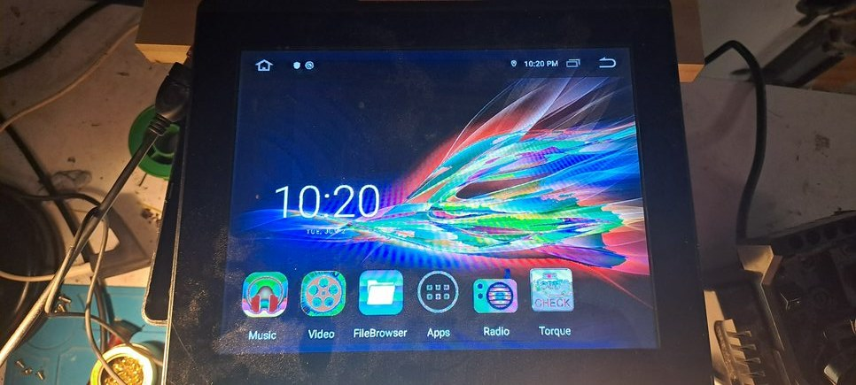

# Porting notes: how Android 10 ended up on a 2016 POS terminal

This is the long version: every wall that came up, and how each one came down. If you're porting a
different RK3368 / PX5-family board, these are the problems you'll meet too.

## Why PX5 and not LineageOS or mainline Linux

What limits this board is the **GPU**. The PowerVR G6110 needs Imagination's closed userspace driver.
The newest one built for the RK3368 shipped in Rockchip's **PX5** (automotive RK3368) Android 9/10
releases, which the car head-unit scene still keeps alive.

- **Mainline Linux** boots fine on the RK3368, and was tested here: Linux 5.4 reached a busybox shell
  from the recovery slot. But Mesa's PowerVR driver lists the G6110 as unsupported, so a browser
  would render in software. That's slower than stock.
- **LineageOS** would need the same PX5 vendor blobs and kernel underneath, so it ends up at
  LineageOS 17.1 = Android 10 anyway, for a lot more work.
- **PX5 Android 10** gets the GPU driver, a 4.19 kernel and Android 10. Android 10 is the version that
  matters, because current Chrome/WebView and the HA app need it.

Source image: `CHS7_PX5_10.0_IMG(20200603)`, a Microntek (MTC/HCT) head-unit build. It's
**userdebug**, which keeps `adb root`.

## 1. Getting root and a safe place to experiment

The stock Citaq image turned out to be a **userdebug** build (`test-keys`, `ro.adb.secure=0`) with
network adb on by default. `adb root` just works, no exploit needed. That allowed:
- a full eMMC dump over adb (`dd`), with no need for maskrom and the case open, and
- writing to any partition from a running system.

The **recovery slot** is self-contained: kernel, ramdisk and a full copy of the resource partition
(logos and DTB), all inside one boot image. `adb reboot recovery` boots it once, and the next boot is
stock again. Every experiment lived there until the very end.

## 2. Convincing the 2019 U-Boot to boot a foreign kernel

The first custom recovery image was rejected on serial with `boot or recovery image sha mismatch!`.
Disassembling U-Boot (`2017.02-RK3368-06`) showed Rockchip's own hash recipe. It's SHA-1 over:
- kernel, ramdisk and second, each followed by its 32-bit size
- then header bytes **0x20–0x240** (`tags_addr`, `page_size`, name and cmdline)

That's not the AOSP recipe. A second rejection followed: the hash runs on the crypto engine fed in
4-byte words, so a ramdisk whose size isn't a multiple of 4 hashes wrong. Every chunk is now padded to
16 bytes (`tools/rkbootimg.py`).

Other things the old U-Boot does, found from the disassembly and serial logs:
- it always copies the kernel to **0x280000**, so it needs `TEXT_OFFSET 0x80000`. The PX5 4.19 Image
  has that.
- it takes the FDT from `rk-kernel.dtb` **inside the image's RSCE "second"**, so the new DTB never
  touches the shared resource partition.
- it **ignores the boot header cmdline**, but puts the DTB's `/chosen/bootargs` in front of the
  parameter-partition cmdline. Android's `ro.boot.*` keep the first value, **so the DTB controls the
  whole kernel command line**: partition map, serial number, firmware path, country code. This trick
  removed any need to touch the parameter partition.
- the PX5 DTB has no `/memory` node (its newer U-Boot adds one). The Citaq U-Boot fails that fixup, so
  the DTB adds `0x200000 + 0x7fe00000` itself.
- the PX5 put its FIQ debug console on UART1, which on the Citaq is **the receipt printer**. The
  console moved to UART2 (the debug pads), in plain-IRQ mode, so it doesn't depend on trust-zone calls
  the older ATF might not have.

**First light:** the PX5 kernel booted on the stock U-Boot to a test initramfs. Results: 8 CPUs, the
eMMC at HS200, LVDS showing static from `/dev/fb0`, and
`RGXGetBVNCConfig: Read BVNC 5.9.1.46` (GPU alive). `firstlight/` reproduces this.

## 3. No repartitioning

PX5 Android 10 expects GPT, a 3 GB dynamic `super`, and A10-style partitions. The Citaq has Rockchip's
legacy layout with a 1.5 GB system. Rather than repartition (with a new bootloader chain and real
brick risk), everything Android 10 needs lives **inside the stock user partition**:
- stock internal storage shrinks to 1 GiB
- `super`, `metadata`, `misc`, `frp`, `security`, `cache` and `userdata` follow it, passed to the
  kernel as `blkdevparts=` from the DTB

Gotchas:
- Rockchip parameter offsets are relative to sector **0x2000**. Forget the +4 MiB and everything is
  misplaced.
- Stock 5.1's busybox is 32-bit without large-file support, so `dd seek=` past 2 GiB fails silently.
  A tiny static helper, `rkio`, does 64-bit `pwrite`/`pread`.
- PowerShell mangles binary `adb shell` output, so everything is MD5-checked on both ends.

## 4. The boot loops, in order

| # | Symptom | Cause | Fix |
|---|---|---|---|
| 1 | reboot to recovery forever | `/data` set to `fileencryption=software`; `tee-supplicant` exits (no OP-TEE in the Citaq trust image) → `enablefilecrypto` fails | ramdisk fstab patched; the vendor fstab inside `super` gets the same-length swap `fileencryption=software` → `check,check,check,check` (`super_to_citaq.py nofbe`) |
| 2 | kernel panic in `pvr_sync_open` | GPU firmware `rgx.fw.signed.5.9.1.46` lives in `/vendor/firmware`, which isn't on this kernel's search path → device init fails → NULL firmware heap | `firmware_class.path=/vendor/firmware` in the DTB bootargs. GPU then comes up (a DDK version-mismatch warning is harmless) |
| 3 | `system_server` aborts every 11 s | `Could not register INotify for /dev/input`: no input device exists at all | enable `gpio-keys` (the power button, same pin as stock) |
| 4 | `FATAL EXCEPTION IN SYSTEM PROCESS` in `MicrontekServer` | the car framework asks the car MCU for settings, gets `null`, then calls `.equals()` on it | see 5 |

## 5. Patching out the car

Every MTC component goes `CarManager → "carservice" binder → CarService.getParameters →
native_getParameters` (a serial link to the car MCU). With no MCU, it returns `null`.

- **First patch:** rewrite `CarService.getParameters` in `services.jar` so `null` becomes `"0"`. It was
  done in place, with the same bytecode length and the dex SHA-1, Adler-32 and zip CRCs fixed up. It
  made **no difference**, because ART kept running the **precompiled** `services.odex`.
- **Hiding the odex:** a same-length directory-entry rename (`services.odex` → `services.odeX`) straight
  in the ext4 image, so ART has to load the jar. This is safe because those filesystems have no
  `metadata_csum`.
- **Still crashing, and now the real cause:** `CarService`'s *constructor* called the native method
  directly, threw, and `carservice` was never registered at all. So every `CarManager` call returned
  `null`. The second patch sends those 7 call sites through the null-safe wrapper, which also catches
  exceptions.

After that: `sys.boot_completed=1`. The patches are in `patches/` as byte diffs with MD5 guards, applied
on the device by `tools/super_files.py`.

## 6. Display, touch, USB

- **Colours wrong:** this was the first Android 10 boot, still with the car launcher, and with the
  banding and false colours you get when the LVDS runs in the wrong mode:

  

  This kernel ignores `rockchip,data-mapping` and reads the panel's `bus-format`. With
  none set it ran 18-bit. VESA-24 (also the driver default) was still wrong. **JEIDA-24 (`0x1012`)** is
  right.
- **No touch driver** in the PX5 kernel (it has Goodix, not Ilitek), and an out-of-tree module would
  hit the same CRC problem as Wi-Fi. So `ilits` is a ~200-line userspace driver: it reads the ILI2105
  over `/dev/i2c-2` (mainline `ili210x` protocol) and injects a multitouch device through `uinput`.
  It's started by repurposing the vendor's **`akmd`** init service (a compass daemon with no compass)
  with a same-length edit of its `.rc` file.
- **USB devices ignored:** the rear GL850G hub fails on autosuspend (`error -71`) and then ignores new
  devices. Fixed with `usbcore.autosuspend=-1`.
- **JP2 stuck in host mode:** the PX5 kernel forces OTG to host, and that survives a warm reset. The DTB
  sets device mode, so adb over JP2 works.

## 7. Wi-Fi

See [WIFI.md](WIFI.md). In short:
- the stock DT names the wrong chip (it's an AP6256 with 5 GHz, not an AP6212)
- the vendor module is built for a different kernel with a different `struct device` size, so it was
  rebuilt with the kernel's exact CRCs
- enabling SDIO renumbered the eMMC, until the DT nodes were reordered

## 8. Bluetooth

See [BLUETOOTH.md](BLUETOOTH.md). The chip answered straight away once its pins were set by hand. Getting
Android to use it took four fixes:
- a `wireless-bluetooth` DTB node, so the rfkill switch exists
- the BCM4345C5 firmware, which the ROM doesn't have
- the PX5 **GPS service holds UART0**. Stopping it hangs the boot, because `system_server` waits for the
  GNSS HAL forever. Pointing it at `/dev/ptmx` (a pseudo-terminal nobody writes to) frees the port and
  keeps everyone happy.
- the **MTC Bluetooth app fakes being on**. It reports ON without ever starting the controller, unless the
  property `hct.bt.org` is `true`. That one property brings back stock Android 10 behaviour, with no APK
  patch (which would have meant re-signing a platform-signed app).

## 9. Sound

- The stock DT lists an **ES8316** codec. It isn't fitted (the stock boot log shows its probe failing),
  and the real codec is a **Realtek RT5651**.
- Silence even with the whole DAPM path on: this kernel's rt5651 driver never enables MCLK. Putting a
  `clocks` property on the simple-card codec node makes simple-card enable it.
- The speaker amp enable is **active high**. The stock DT's flag is wrong.
- Rockchip's audio HAL picks its route table by sound-card id, so the card has to be named
  `realtek,rt5651-codec` (→ `realtekrt5651co`).
- **Volume:** this MTC build applies no software volume, because the car MCU did that. So `volshim`
  watches Android's media volume and writes the codec's digital DAC volume. The HAL's route feeds the
  outputs straight from the DAC, so the analog volume controls do nothing. The MTC volume slider and
  keys still go to the absent MCU.
- `ro.config.media_vol_steps` must be set before `AudioService` starts. Otherwise it asks the MCU for the
  maximum, gets `"0"` from our patch, and ends up with a 0-step volume range.
- **Headphones played through the speakers too.** The jack and the speaker amp both hang off the codec's
  headphone output (muting line out changed nothing), so the only split is the amp's enable pin. Stock Android 5
  had a headset driver for that; car head units have no jack, so the PX5 build doesn't. The DTB takes the amp
  pin away from the rt5651 driver (it treats it as optional) and turns on the jack-detect pull-up with a
  pin-controller hog. Without the pull-up the pin reads 0 whether a plug is in or not. A boot-hook loop then
  mutes the amp while the jack is in. Trade-off: the amp no longer switches off when audio is muted.

## 10. Backlight

The MTC `pwm-backlight` driver ignores `brightness` and holds the PWM at 100 %. The DTB points that
driver at an **unused** PWM (PWM3), so Android's lights HAL still has a sysfs file to write.
`blshim` then mirrors that value onto the real backlight PWM0 through the PWM sysfs interface.

## 11. Google Play

- The shipped 2019 Play services fail check-in. Current ones crash with a NullPointerException in
  `PowerManager.addThermalStatusListener`, because the MTC `SystemServer` never starts
  `ThermalManagerService`. `thermalstub` registers a do-nothing `IThermalService` as `thermalservice`
  from `app_process`.
- Check-in then fails with `"id.so" is not a valid serial number`. Rockchip's `drmservice` invents the
  serial from PX5 vendor storage. `androidboot.serialno` in the DTB isn't copied to `ro.serialno` by
  this init, and a boot script runs too late for `setprop` on a read-only property. So `propset` edits
  the value in place in `/dev/__properties__`, the way bionic's own writer does: dirty bit, value,
  serial counter, futex wake.
- After that: sign-in, Play certification, WebView 157 and the current HA app.

## 12. Living without a PMIC driver

The PX5 kernel has no RK818 driver, which turned out mostly fine. U-Boot programs the rails and the
charger, and the charger runs on its own. Writing a driver would hand the kernel control of every
rail (CPU, DDR, LCD) just to get a battery percentage. Two problems did come up:

- **Battery pull:** the RK818 drops to OTP defaults. The LCD logic supply and the touch supply switch
  off, the 32 kHz Wi-Fi clock stops, and the charger moves to 4.2 V / 2 A. Nothing in the PX5 DT
  drives the LCD power GPIOs either. The boot hook checks and restores all of it, re-probes SDIO, and
  logs what it did.
- **Power-off:** `svc power shutdown` only halts the SoC, leaving the backlight on and the battery
  draining. The back switch cuts DC, so the hook watches the RK818's input-present bit. Five seconds
  after DC goes away it does a clean shutdown: broadcast, stop the framework, sync, emergency remount,
  then **RK818 DEV_OFF**, the same thing mainline's `rk808` `pm_power_off` does.

## 13. Speed and heat

- CPU DVFS came back with the real **SYR827** regulator driver (`fan53555`).
- The tsadc needed two fixes:
  - a fixed reference voltage instead of the scaling vdd_cpu
  - `latency-bound = 0x7fffffff`, because the legacy driver otherwise asks the MCU, which always
    answers "25 °C"
- With real temperatures, 1512 MHz at 1.35 V hung the board after 30–70 s of full load (sensor reached
  75 °C with no heatsink). The big cluster is capped at 1200 MHz.
- GPU runs 200/288/400 MHz.
- Boot time: 28.4 s → **22.5 s**. CPU-bound benchmark: −36 %.
- `cmd package compile -m speed -a` and removing 51 car/bloat apps did the rest.

## 14. Making it the default

The stock boot slot holds a legacy Rockchip `KRNL`-wrapped ramdisk; the stock kernel is in its own
partition. The Android 10 image (kernel + ramdisk + DTB in one Android boot image) goes into the boot
slot. U-Boot accepts it ("Load FDT from boot image") and plain power-on boots Android 10. The recovery
slot keeps a spare copy. The stock kernel partition and stock `/system` are untouched, so rolling back
means writing one 32 MiB slot.

## Tips for the next person

- Get a serial console on day one. Most of the problems above were invisible without it.
- Test shell scripts for the stock recovery's busybox with `env -i PATH=…`. Its ash has no
  `echo`/`[`/`test` builtins, and your host's versions will hide that.
- `/proc/last_kmsg` holds the previous boot's kernel log after a warm reboot.
- Keep every experiment in the recovery slot until it has booted a dozen times, including after a full
  battery-out power cycle.
